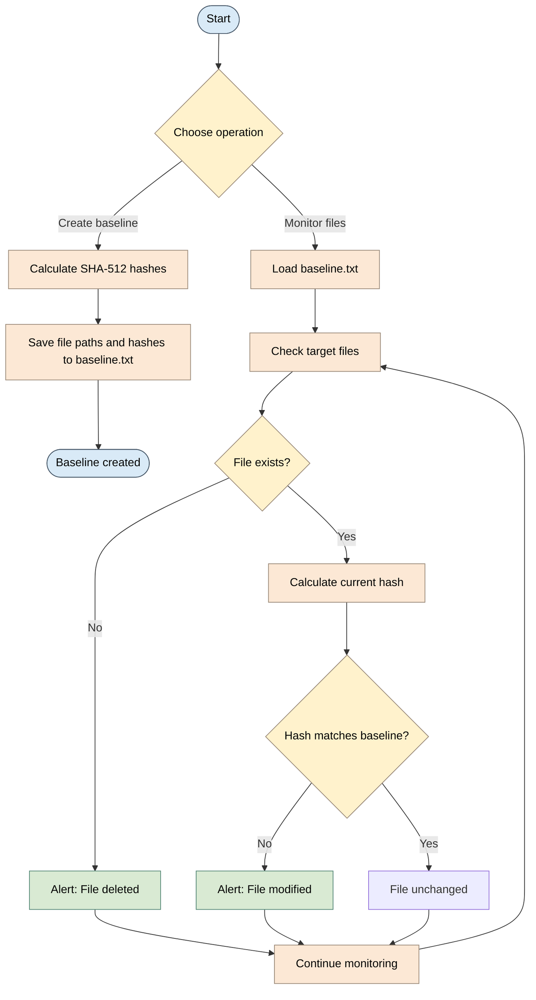

## What This Is

A lightweight PowerShell-based File Integrity Monitoring (FIM) tool that creates a SHA-512 baseline for a target folder and monitors for created, modified, or deleted files. Designed for simple security monitoring and lab environments without requiring a full SIEM or file-monitoring stack.

## Tech Stack

- **Language:** PowerShell
- **Runtime:** Windows PowerShell or PowerShell 7
- **Built-in cmdlets:** `Get-FileHash`, `Get-ChildItem`, `Get-Content`, `Test-Path`, and `Out-File`

## Project Structure

```text
.
├── Fim.ps1       # PowerShell entry point and monitoring loop
├── Files/        # Sample files used for baseline testing
│   ├── a.txt
│   ├── b.txt
│   ├── c.txt
│   └── d.txt
└── baseline.txt  # Generated when collecting a baseline
```

## File Integrity Monitor (FIM)


